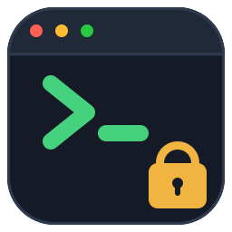

# bullsTerminal

SSH로 연결한 타겟에서 **대화형 터미널 + 기능별 명령 일괄 실행 + SFTP 파일 전송**을 제공하는
데스크톱 GUI 앱(우분투·윈도우).
(PySide6 + Paramiko + YAML) — 자세한 설계는 [DESIGN.md](DESIGN.md) 참고.

<br clear="left">

> 이전 이름은 `rsCommand` 입니다. 기존 설정(`~/.config/rsCommand/*.yaml`)은 최초 실행 시
> `~/.config/bullsTerminal/` 로 **자동 복사**되므로 명령·즐겨찾기를 그대로 사용할 수 있습니다.
> (원본은 지우지 않습니다.)

## 설치 & 실행 (우분투 데스크톱)

```bash
cd /path/to/bullsTerminal      # 소스 위치(Samba 공유 가능)
python3 -m venv .venv
source .venv/bin/activate
pip install -r requirements.txt
python main.py
```

> 헤드리스 서버라면 GUI 표시를 위해 데스크톱 세션 또는 X11 forwarding(`ssh -X`)이 필요합니다.

## 화면 구성

- **좌측(좁은 패널)**: 기능 그룹 + 명령 목록 + 실행 버튼. CRUD는 헤더의 컴팩트 버튼(＋/이름·수정/삭제).
- **우측 터미널 탭**: 대화형 터미널 탭들. 탭 제목은 `user@host`. 우상단 `+ 터미널` 버튼으로 여러 개 열 수 있음. 시작 시 첫 연결 다이얼로그가 뜹니다.
- **도구 도킹 패널(탭: 클립보드 / 파일)** — 우측/하단/좌측 도킹 또는 분리(플로팅), `보기` 메뉴로 토글:
  - **파일 탭(WinSCP 스타일 SFTP)**: 상단은 **활성 터미널의 리모트 PC**, 하단은 **로컬 PC**(기본 `내 문서`, `폴더 선택`으로 변경). 목록은 **이름/크기/수정시간** 컬럼 + **시스템 파일 아이콘**(확장자별). 폴더 더블클릭 탐색, `상위`/`새로고침`.
    - **▼ 다운로드**(원격→로컬) / **▲ 업로드**(로컬→원격) — Ctrl/Shift 다중 선택, **진행률(%) 표시**, 백그라운드 전송으로 앱이 멈추지 않음
    - **우클릭 메뉴**: 다운로드/업로드, 이름 변경, 새 폴더, 삭제, 새로고침
    - **삭제는 항상 확인 팝업** 후 수행(파일·빈 폴더)
    - **터미널 경로 동기화**(체크박스): 켜면 현재 터미널의 `cd` 경로에 맞춰 리모트 목록이 자동 이동하고, **터미널 탭을 전환하면** 그 터미널의 경로로 리모트가 새로고침됩니다. (OSC 7 사용 — 옵션을 켜면 셸에 경로 보고를 자동 주입: **bash → PROMPT_COMMAND**, **임베디드 BusyBox `ash`/`sh` → PS1 확장**으로 폴백. ash 는 PS1 파라미터 확장이 켜진 빌드에서 동작. zsh 등은 미지원)
- **클립보드 기록 탭**: 시스템 클립보드에 복사된 텍스트 중 **셸 명령처럼 보이는 것만** 목록으로 쌓입니다(한글 문장·URL·일반 텍스트는 제외). **클릭** → 하단 입력창에 표시(수정/실행), **더블클릭** → 즉시 실행, **Ctrl/Shift로 여러 행 선택**(선택한 명령들이 줄바꿈으로 입력창에 모여 줄마다 실행 가능). 상단 **키워드 필터**로 목록을 좁힐 수 있고(공백으로 여러 키워드 입력 시 **모두 포함**하는 항목만, 대소문자 무시, 우측에 `표시/전체` 개수 표기), 필터 상태에서도 선택·실행·삭제가 올바른 항목에 적용됩니다. `삭제`는 선택 항목 여러 개 동시 삭제, `전체 삭제`는 기록+시스템 클립보드 비우기. 패널은 **우측/하단/좌측 도킹 또는 분리(플로팅)**, `보기` 메뉴로 토글. (세션 메모리, 최대 100개)
- **우측 하단 명령 입력 패널**: 목록에서 고른 명령이 표시되며(여러 줄 편집 가능), 수정 후 **Ctrl+Enter** 또는 `입력`으로 현재 터미널에 전송. 터미널과의 경계를 드래그해 **높이를 늘릴 수 있습니다**. **bash 구문 강조**(명령/키워드/변수/옵션/문자열/주석/연산자 색상)로 가독성을 높였습니다.
- **메뉴 / 아이콘 버튼**:
  - 메뉴바 `연결`(새 터미널·재연결·연결끊기), `설정`(글꼴·크기 변경), `명령 관리`(백업·복원)
  - 상단 우측 아이콘 버튼: 글꼴 / 재연결 / 연결끊기 (메뉴와 동일 기능, 빠른 접근)
- **폰트 변경**: `설정 → 글꼴·크기 변경`(또는 상단 글꼴 아이콘)으로 터미널·명령 입력창의 **폰트/크기**를 바꿉니다(모든 터미널 탭 즉시 적용, `~/.config/bullsTerminal/settings.yaml`에 저장). 기본 Monospace 12pt.
- **탭별 다른 IP 연결**: 각 터미널 탭은 **자신의 SSH 연결**을 가집니다. `+ 터미널`을 누르면 연결 다이얼로그가 떠서 원하는 호스트/IP로 연결할 수 있습니다(직전 연결 정보가 프리필됨 → 같은 서버면 바로 `연결`).

배치 실행 결과도 **터미널에서 그대로** 확인합니다(별도 배치 콘솔 없음).

## 사용법 — 명령 실행 (터미널에서)

1. 실행하면 **SSH 연결 다이얼로그**가 뜹니다 → host/port/user/password 입력 후 `연결`.
   - 비밀번호는 메모리에만 보관하며 디스크에 저장하지 않습니다.
2. 좌측 **기능 그룹**을 선택하면 그룹의 **명령 목록**이 표시됩니다(제목만 표시, 전체 명령/설명은 툴팁).
3. 실행 방법:
   - **명령 클릭** → 터미널 하단 **명령 입력 패널**에 그 명령어가 표시됩니다. **일부 수정**(여러 줄 가능) 후 **Ctrl+Enter** 또는 **`입력`** 버튼을 누르면 그때 현재 터미널로 전송/실행됩니다. 여러 줄이면 줄마다 순차 실행됩니다.
   - **명령 더블클릭** → 수정 없이 즉시 실행
   - 여러 개를 **체크** 후 `▶ 선택` / `▶▶ 그룹` → 체크한(또는 그룹 전체) 명령을 `;`로 이어 순차 실행
   - 헤더의 **`전체`** 체크버튼으로 전체 선택/해제(부분 선택 시 중간 상태)
4. 결과는 활성 터미널에 그대로 표시됩니다(터미널이 없으면 자동 생성). `확인` 옵션이 켜진 명령은 실행 전 확인창이 뜹니다.

## 사용법 — 대화형 터미널

- 우상단 `+ 터미널`을 누르면 연결 다이얼로그가 뜨고, 지정한 호스트로 **새 터미널 탭**이 열립니다. **탭마다 다른 IP**로 연결할 수 있습니다.
- **즐겨찾기(빠른 연결)**: 연결 다이얼로그 상단에서 즐겨찾기를 **선택**(입력 자동 채움)하거나, 현재 입력을 **`저장`**(이름 지정, 비밀번호 저장 여부 선택)/**`삭제`** 할 수 있습니다. 메뉴 **`연결 → 즐겨찾기`** 에서 항목을 클릭하면 **바로 연결**(비밀번호 저장 시 즉시, 아니면 비밀번호만 입력)됩니다. 저장 위치: `~/.config/bullsTerminal/favorites.yaml`. ⚠ 비밀번호를 저장하면 **평문**으로 기록됩니다.
- pyte 기반 완전 에뮬레이터라 **vim/htop/top/색상** 등 전체화면 TUI도 정상 동작합니다.
- **기능키 전반 지원** (xterm 규격):
  - Tab / Shift+Tab / Esc / Backspace / Enter
  - 방향키·Home·End·Insert·Delete·PageUp·PageDown (수정자 포함: 예 Ctrl+←, Shift+Alt+↑)
  - **F1~F12** (수정자 포함)
  - **Ctrl 조합**: Ctrl+A~Z, Ctrl+[ ] \\ ^ _ , Ctrl+Space
  - **Alt(메타) 조합**: Alt+문자 → ESC 접두 전송 (Alt+B/F 단어 이동 등)
  - **IME 조합 입력**(한글 등) 확정 문자열 전송 (시스템 IME가 Qt에 연결된 경우)
- **스크롤백(과거 로그)**: 세로 스크롤바 / 마우스 휠 / **Shift+PageUp·PageDown**으로 지난 출력을 볼 수 있습니다(최대 5000줄). 키 입력·붙여넣기·배치 실행 시 자동으로 맨 아래로 이동합니다.
- **텍스트 선택/복사/붙여넣기**:
  - 마우스 **드래그로 선택** (선택 즉시 PRIMARY 클립보드에 복사)
  - **Ctrl+Shift+C** 복사 / **Ctrl+Shift+V** 붙여넣기
  - **가운데 버튼 클릭** → PRIMARY 붙여넣기, **우클릭 메뉴**로 복사/붙여넣기
- 상단 `재연결`(활성 탭 같은 호스트로 재연결) / `연결끊기`(활성 탭 닫기). 탭의 ✕로 개별 종료.
- **내용 저장**: 우클릭 → **전체 내용 저장**(현재 스크롤백 스냅샷) / **세션 로그 시작·중지**(로그 시작 이후 **모든 출력을 파일에 실시간 기록** — 스크롤백 5000줄 한도와 무관하게 무제한). 메뉴 `보기 → 활성 터미널 내용 저장`도 제공.
- **연결은 백그라운드 스레드에서 수행**되어(진행 중 "연결 중..." 창 + 취소 가능) 응답 없는 호스트에서도 앱이 멈추지 않습니다. 연결 후 30초 간격 **keepalive**로 끊긴 연결을 감지·유지합니다.

## 명령 관리

- 앱 내에서 그룹/명령을 추가·편집·삭제. 변경 즉시 저장됩니다.
- 기능 그룹과 명령 목록은 **이름(라벨) 기준 자동 정렬**됩니다(대소문자 무시).
- 좌측 패널의 **기능 그룹 / 명령 목록 사이 경계를 드래그**해 높이를 조절할 수 있습니다(좌우 패널 경계도 드래그 가능).
- 명령 옵션: **실행 전 확인창** (`confirm`, 위험 명령용)
- 저장 위치: `~/.config/bullsTerminal/commands.yaml` (직접 편집도 가능)

### 백업 / 복원 (다른 PC로 이전)

- 상단 메뉴 **`명령 관리`**:
  - **명령 백업 (내보내기)** → 그룹·명령 전체를 YAML 파일로 저장.
  - **명령 복원 (가져오기)** → 백업 파일을 선택해 불러오기. **병합**(기존에 추가, 중복 명령 제외) 또는 **교체**(기존 대체) 선택 가능.
- 백업 파일을 USB/네트워크로 옮겨 다른 PC의 bullsTerminal에서 `복원`하면 동일한 명령 세트를 사용할 수 있습니다.

## sudo 명령

- 터미널(대화형 PTY 셸)에서 실행되므로, `sudo`가 비밀번호를 물으면 **터미널에서 직접 입력**하면 됩니다.
- 배치 실행은 선택 명령들을 `;`로 이은 **한 줄**로 보내기 때문에, sudo 프롬프트가 뒤 명령을 비밀번호로 삼키지 않고 정상적으로 터미널에서 입력을 받습니다.

## 알려진 제약

- SSH 인증은 **비밀번호** 방식만 지원 (설계상 선택).
- 배치 실행은 단순 순차(`;`) 방식이라 명령별 exit code 표시/실패 시 자동 중단은 제공하지 않습니다(터미널에서 결과를 직접 확인). 실행 중단은 터미널에서 `Ctrl+C`.

## 단일 실행파일 빌드 (PyInstaller)

매번 venv/pip 없이 실행하도록 **단일 실행파일**을 만들 수 있습니다.
PyInstaller는 크로스 컴파일이 안 되므로 **각 OS에서 각각 빌드**해야 합니다.

### 리눅스
```bash
bash build-linux.sh
# 산출물: ~/bullsterminal-build/dist/bullsTerminal
```
- 배포 대상 중 **가장 오래된 배포판**에서 빌드해야 glibc 호환성이 좋습니다.
- 실행 머신에 xcb 라이브러리 필요: `sudo apt install -y libxcb-cursor0 libxkbcommon-x11-0`
- Samba 공유(noexec)에서는 실행이 막히므로 산출물을 로컬 경로(홈 등)에 두고 실행하세요(스크립트가 홈에 생성함).

### 윈도우
```bat
build-windows.bat
:: 산출물: dist\bullsTerminal.exe
```
- 실행파일에 **앱 아이콘이 내장**되며(작업표시줄/탐색기), 바로 가기를 만들어 쓰면 됩니다.

### 아이콘 · 바로가기
- 아이콘 원본: [`assets/bullsterminal.svg`](assets/bullsterminal.svg) (터미널 창 + 프롬프트 `>_` + 자물쇠 = secure shell).
  `assets/bullsterminal.ico`(16~256px 멀티 사이즈, 윈도우)와 `assets/bullsterminal.png`(256px)는
  아래 명령으로 다시 만들 수 있습니다(외부 의존성 없음).
  ```bash
  python tools/make_icon.py
  ```
- **우분투 메뉴 등록**(아이콘·런처·검색):
  ```bash
  ./packaging/install-linux.sh ~/bullsterminal-build/dist/bullsTerminal
  ```
  실행파일은 `~/.local/bin`, 아이콘은 `~/.local/share/icons/hicolor/...`,
  런처는 `~/.local/share/applications/bullsTerminal.desktop` 에 설치됩니다.

### 참고
- onefile 실행파일은 크기가 크고(약 100~200MB) 최초 실행 시 압축 해제로 조금 느립니다.
- 한글 입력(IME)은 번들 Qt 특성상 실행 환경의 입력기 설정(`QT_IM_MODULE=ibus` 등)이 필요할 수 있습니다.

## 구조

```
main.py           진입점 (앱 아이콘 설정 → 연결 다이얼로그 → 메인 윈도우)
core/models.py    Group / Command 데이터 모델
core/store.py     commands.yaml 로드/저장 (+ 구 rsCommand 설정 자동 이전)
core/resources.py 번들/소스 공통 리소스 경로 해석
ssh/client.py     Paramiko 래퍼 (비밀번호 인증, 대화형 셸 채널)
ui/connect_dialog.py  연결 입력
ui/main_window.py     메인 (좌측 명령패널 + 우측 터미널 탭)
ui/command_editor.py  명령 추가·편집
ui/terminal_widget.py pyte 기반 대화형 터미널 위젯
assets/               앱 아이콘 (svg 원본 / ico / png)
tools/make_icon.py    아이콘 생성기 (표준 라이브러리만 사용)
packaging/            리눅스 .desktop 런처 + 설치 스크립트
```
